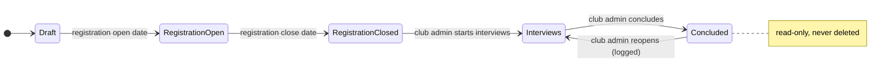
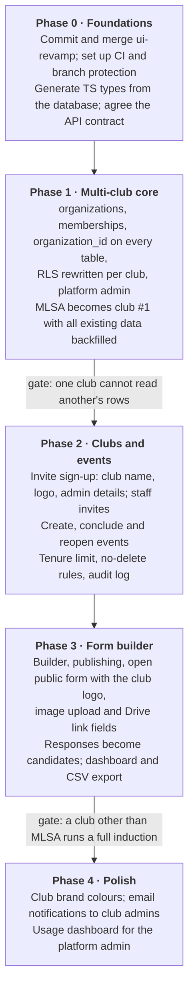

# v2 Plan: Multi-Club Inductions Platform

As of 31 Oct 2026. Living version: [Claude doc](https://claude.ai/artifact/FuTZRsatfnJreQVoth1nzd).

## Overview

We are turning the MLSA induction app into one platform that every GIKI club and society can use to run its own inductions. Each club gets its own dashboard where it builds and publishes a registration form, creates induction events, and runs interviews with the queue, panel, projector and results screens we already have.

Today the app serves one club: there is a single `inductions` table, roles are global (`admin`, `queue_manager`, `panelist`), candidates arrive through CSV import or Google Form sync, and events are created by hand in the SQL editor. The work below makes every record belong to a club, replaces Google Forms with our own form builder, and makes events self-serve.

Pricing is out of scope until the platform is built.

## Decisions locked

These were agreed on 31 Oct 2026 and are the requirements both teams build against.

| Topic | Decision |
| --- | --- |
| Platform owner | MLSA runs the platform and is the platform admin. |
| Club onboarding | Invite-only. The platform admin sends an invite link; the club signs up through it and becomes that club's admin. No open sign-up. Sign-up collects the club's name, logo and admin details. |
| Club staff | Each club admin invites their own queue managers and panelists. No shared fixed credentials. |
| Student identity | No student accounts or sign-in; the form is a public link. Students type their GIKI email, which must match the pattern `u2023123@gik.edu.pk`. The pattern is checked server-side, but ownership of the email is not verified. Reg no. and batch are read from the email (2023 = batch 33, graduating 2027). |
| Interview flow | Same for every club: queue, panels, projector display, evaluations, results. |
| Scheduling | None. No interview slots and no cross-club clash handling. |
| Event dates | Each club sets its own registration and interview dates. Inductions happen at any time of year. |
| Event limit | 2 induction events per club per tenure. A tenure runs 1 Sep to 31 Aug (e.g. Sep 2026 to Aug 2027). |
| Concluding | An event can be concluded. It becomes read-only and is never deleted, nor are its responses, evaluations, chats or images. |
| Reopening | Only that club's own admin can reopen a concluded event. Reopening does not count against the limit. |
| Form builder | Our own form, no Google Forms dependency. No conditional logic in v1. |
| Image upload | One image per image field, max 5 MB, images only. A form may have several image fields. |
| Video | No video uploads. Students submit a Google Drive link instead. |
| Pricing | Deferred until after the build. |

## Roles and permissions

Roles move from one global role per user to a role per club, so one person can be a panelist in one club and an admin in another.

| Role | Scope | Can do |
| --- | --- | --- |
| Platform admin | Whole platform (MLSA) | Send club invite links, see every club, change a club's event limit, deactivate a club |
| Club admin | One club | Edit club profile, invite and remove staff, create, conclude and reopen events, build and publish forms, see all responses and results |
| Queue manager | One club's events | Run the queue: send candidates to panels, reorder, mark arrivals and photos |
| Panelist | One club's events | Join a panel, read applications, chat with the panel, submit evaluations |
| Student | Public form link | Fill any published club form; no account and no sign-in |

A club only ever sees its own events, forms, responses and staff. A student's application to one club is invisible to every other club.

## Club onboarding and branding

The invite link opens a one-time sign-up form; when it is submitted the club exists, its admin is signed in, and the club's logo appears on everything students see.

**Collected at sign-up**

| Field | Required | Rules |
| --- | --- | --- |
| Club name | Yes | e.g. Microsoft Learn Student Ambassadors GIKI |
| Short name | Yes | e.g. MLSA; used in URLs and headers |
| Club logo | Yes | Transparent-background PNG, SVG or WebP, max 2 MB; preview shown on light and dark backgrounds before saving |
| Admin full name | Yes | |
| Admin email | Yes | Becomes the admin's login |
| Admin password | Yes | Set by the admin; never shared with MLSA |
| Short description | No | One or two lines shown on the public form |
| Contact email / social links | No | Shown in the public form footer |

The club admin can edit all of these later from the club settings page.

**Where the logo appears**

- Top of every published form, above the form title
- Club dashboard header
- Projector display and the public results page

**Staff invites** work the same way: the club admin sends an invite link for a role, and the staff member sets their name and password through it.

We cannot reliably detect a non-transparent background, so the upload shows the preview and a reminder rather than rejecting the file.

## Data model changes

We keep one Supabase project and one database for all clubs; every club-owned row carries an `organization_id`, and row-level security checks membership in that club. We do not run a separate project per club: 15 copies would mean 15 deploys for every fix.

**New tables**

| Table | Holds | Notes |
| --- | --- | --- |
| `organizations` | One row per club or society | Name, short name, slug, logo path, description, contact links, `max_events_per_tenure` (default 2), active flag |
| `memberships` | User + organization + role | Replaces the global `profiles.role`; a user can have several |
| `club_invites` | Invite links issued by the platform admin | Single-use token, expiry, used-by |
| `staff_invites` | Invites from a club admin to staff | Email, role, expiry |
| `forms` | A form belonging to an event | Current published version pointer |
| `form_versions` | Immutable JSON definition of the fields | Editing a published form creates a new version |
| `form_responses` | One student's answers to one event's form | Answers as JSON keyed by field id + the version answered; reg no. stored per response; duplicates flagged, not blocked |
| `event_audit` | Conclude / reopen history | Who, when, from-state, to-state |

**Changed tables**

- `inductions` becomes the club's **event**: gains `organization_id`, `status`, registration open/close and interview start/end dates, `concluded_at`, `tenure_start`.
- `panels`, `candidates`, `queue_entries`, `interviews`, `messages`, `evaluation_criteria`, `evaluations`, `form_warnings` and photo records gain `organization_id` (or reach it through the event).
- `candidates` links to a `form_responses` row instead of a CSV row; CSV import stays as a fallback.
- Every `has_role(...)` policy becomes "has this role in this row's club".

**Storage**

- Private bucket for form images, path `org/<org id>/event/<event id>/response/<response id>/<field id>`.
- Bucket limits enforce 5 MB and image MIME types (JPEG, PNG, WebP, HEIC); the browser also checks first for a friendly error.
- No delete policy on this bucket or on candidate photos.

**Migration of MLSA**

MLSA becomes organization #1. A migration creates it, backfills `organization_id` on every existing row, and converts each `profiles.role` into an MLSA membership. This is the riskiest single step and must pass the existing pgTAP and integration tests before merge.

## Event lifecycle and tenure rules

An event moves through five states; concluding freezes it but keeps every record, and only that club's admin can reopen it.

Registration opens and closes automatically on the club's dates; the club admin moves the event into interviews and concludes it.

**Rules**

- **Concluded = read-only.** No new responses, evaluations, chat messages or queue changes. Results, applications, chats and images stay viewable and exportable.
- **Nothing is deleted.** There is no delete path for events, responses, candidates, evaluations or images, enforced in the database, not just hidden in the UI.
- **Reopen.** Only the club's own admin can reopen; it returns the event to *Interviews*. Each conclude and reopen is written to `event_audit`.
- **Tenure.** 1 Sep to 31 Aug. An event counts toward the tenure in which its registration opens.
- **Limit.** At most `max_events_per_tenure` (default 2) events per club per tenure, checked inside the create-event database function under a lock so two tabs cannot create a third. Reopening does not count as a new event. The platform admin can change the limit per club.

## Form builder v1 scope

v1 covers what clubs used Google Forms for in inductions, without conditional logic; a submitted response becomes the candidate directly, so CSV export and sync go away.

**Field types**

| Type | Validation |
| --- | --- |
| Short text | Required, max length |
| Long text | Required, max length |
| Single choice (radio) | One option |
| Multiple choice (checkbox) | Min / max selections |
| Dropdown | One option |
| Number | Min / max |
| Email | Format |
| Phone | Pakistani mobile format |
| Date | Optional min / max |
| Linear scale | e.g. 1 to 5, with end labels |
| Image upload | One image, 5 MB max, JPEG / PNG / WebP / HEIC |
| Link | URL; can be restricted to `drive.google.com`, with a hint to set sharing to "Anyone with the link" |

Name, reg no., batch and GIKI email are fixed fields on every form; reg no. and batch are read from the email, which must match the GIKI pattern.

**Builder and publishing**

- Sections (pages), field description, required toggle, reorder by drag.
- Preview as a student before publishing.
- Form accepts responses only while its event is in *registration open* and between its dates.
- Every submission is kept. Submissions sharing a reg no. are flagged in the dashboard and the club decides which counts; v1 has no editing after submit.

**Open-form safeguards**: the email pattern check, a hidden honeypot field and per-IP rate limiting in the submit function stop bots and accidental resubmits. Anyone can still submit under another student's email; that is an accepted risk (see Risks).

**Responses dashboard**

- Table of all responses, search and filter by field.
- Per-candidate view (replaces today's application tabs in the panel screen).
- CSV export.

**Not in v1**: conditional logic, quizzes and scoring, response editing, multiple images per field, video upload, themes.

## Phased roadmap

Phase 1 (multi-club core) blocks everything else; after it, clubs and events, then the form builder.

Until phase 3 lands, a new club can already run an induction using CSV import. No dates are set yet; they depend on team size (see open items).

## Team split and working agreement

The contract between the teams is the generated database types plus `src/lib/api.ts`; anything that changes that contract is reviewed by both teams.

| Area | Owner | Lives in |
| --- | --- | --- |
| Schema, migrations, RLS, database functions (RPCs) | Backend | `supabase/migrations` |
| Edge functions, storage buckets and policies | Backend | `supabase/functions`, `functions/` |
| Database tests | Backend | `supabase/tests` (pgTAP), `tests/integration` |
| Generated TS types | Backend generates, frontend consumes | `src/lib/types.ts` |
| API client | Shared; changes reviewed by both | `src/lib/api.ts` |
| Screens, components, routing | Frontend | `src/` |
| UI tests | Frontend | `tests/unit/web`, `tests/e2e` |

**Working agreement**

- `main` is protected; every change is a PR with one review, and both teams review contract changes.
- CI runs typecheck, unit, integration, pgTAP and e2e tests on every PR.
- A migration never edits an old migration file; it adds a new one.
- Every new table ships with RLS enabled and a test proving one club cannot read another's rows.
- Before the team starts, the `ui-revamp` branch (about 50 uncommitted files) is committed and merged.

## Risks and open items

| Risk | Impact | Mitigation |
| --- | --- | --- |
| Backfilling `organization_id` on live MLSA data | Broken permissions or lost access for MLSA | Rehearse on a copy of production; existing pgTAP and integration tests must pass |
| Cross-club data leak through a missed RLS policy | One club sees another's applicants | Isolation test per table, required in CI |
| Students share Drive links that are private | Panelists hit "request access" mid-interview | Hint on the link field; optional link check on submit |
| Open form: someone submits under another student's email | Fake or duplicate applications | Duplicates flagged by reg no.; the panel can check the student ID card at the interview |
| Supabase free tier limits with many clubs | Slow realtime or storage cap during an induction | Monitor usage; revisit when pricing is discussed |

**Still to decide**

- [ ] Team size and names of the backend and frontend leads
- [ ] Target date for the first club other than MLSA to go live
- [ ] Whether panels check student ID cards at the interview to confirm identity
- [ ] Whether an event counts toward a tenure by its registration-open date (proposed) or its creation date
- [ ] Whether the platform admin needs an override to reopen events if a club admin is unavailable
